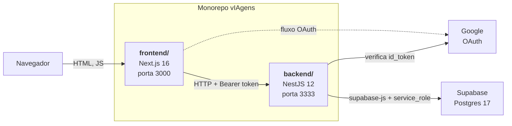
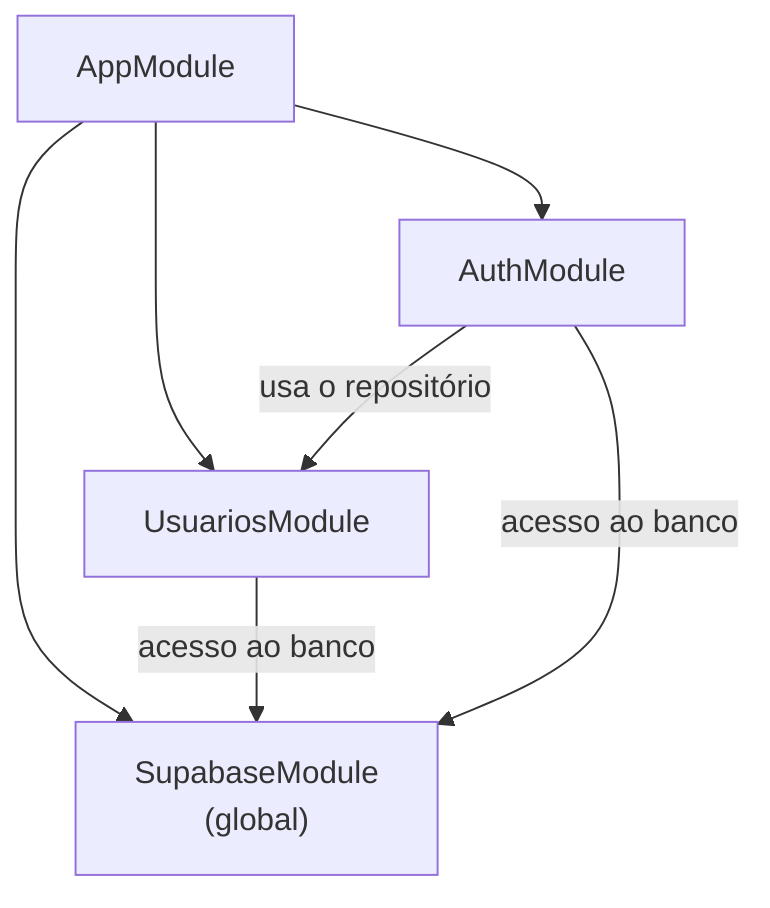
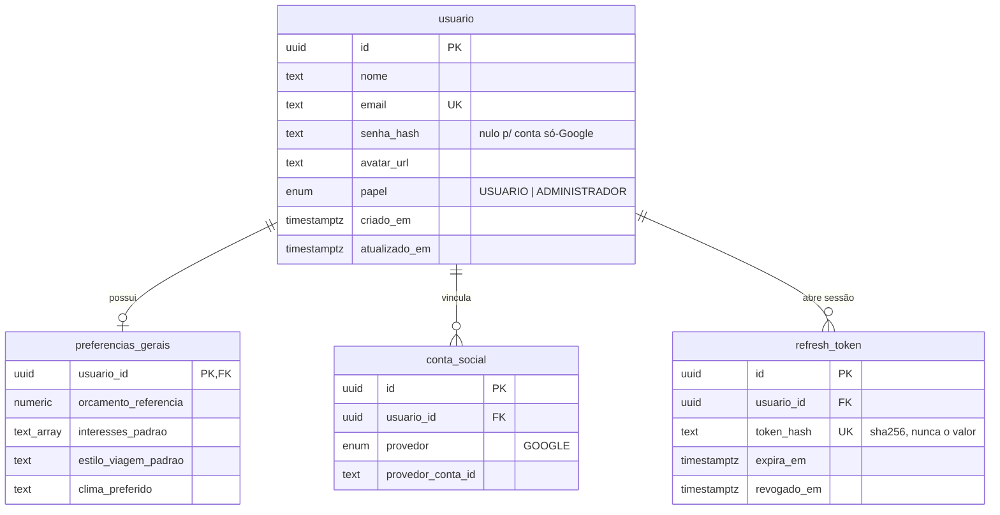
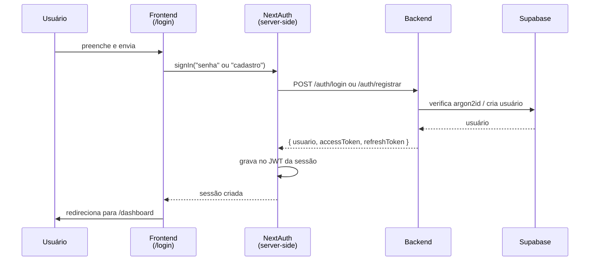
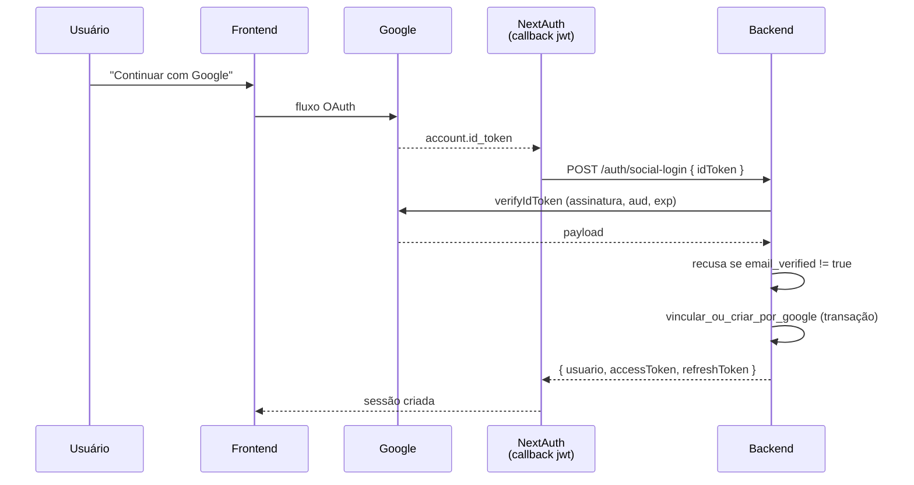
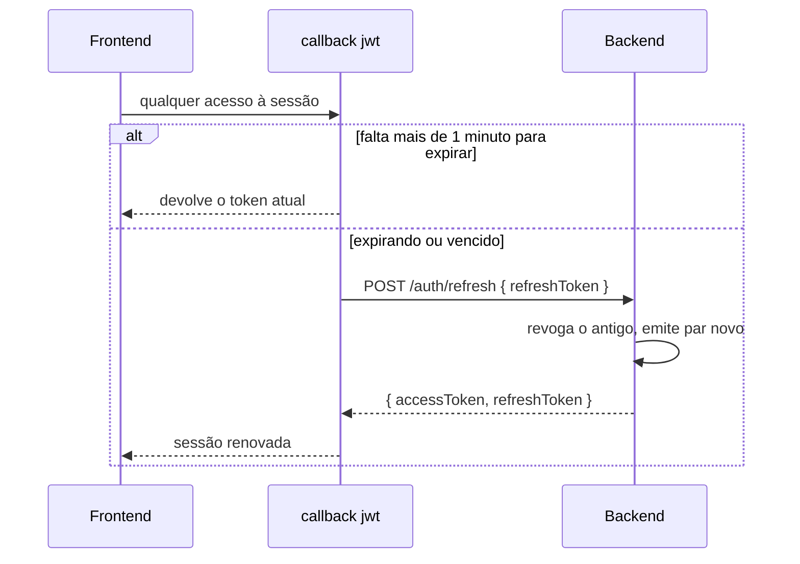

# vIAgens

Plataforma web que gera roteiros de viagem personalizados usando IA.

Projeto acadêmico, Grupo 03. Professor: Edgar Salardani Senhorello.

| Integrante | Frente |
|---|---|
| Rafael Bassul | Full Stack / N8N / APIs |
| Lucas Bonato | Dados / Back-end / Automações |
| Gianluca Sampogna | Mobile / Front-end |
| Giovanni Persio | Dados / Machine Learning / IA |
| Gabriel Alcantaro | Análise de Dados |

---

## O que funciona hoje

A entrega atual cobre **autenticação e usuário**. A geração de roteiro por IA
é a próxima entrega e ainda não existe.

Funcionando ponta a ponta:

- Cadastro por e-mail e senha
- Login por e-mail e senha
- Sessão que se renova sozinha, com logout que revoga de verdade
- Tela de perfil lendo dados reais do banco
- Login pelo Google — **implementado, mas inoperante** enquanto
  `GOOGLE_CLIENT_ID` não for preenchido

---

## Arquitetura

Três peças, e o motivo de serem três:



**Por que backend separado, e não API routes do Next.** O `src/services/api.ts`
do frontend já apontava para `http://localhost:3333` desde o começo. Manter o
backend como serviço próprio também deixa a parte de dados e ML (Giovanni e
Gabriel) trabalhar contra uma API estável, sem depender do ciclo de vida do
Next.

**Por que o backend fala com o banco, e não o frontend.** O frontend nunca toca
o Supabase. Quem usa a chave `service_role` é só o backend, e ela nunca vai
para o navegador. Se ela chegasse ao bundle do Next, qualquer pessoa abriria o
DevTools e leria a tabela de usuários inteira, hashes de senha incluídos.

**Por que o backend valida o `id_token` do Google.** O frontend faz o fluxo
OAuth, mas o backend não acredita em nada que o frontend afirme sobre quem o
usuário é. Ele recebe o token assinado e confere a assinatura com o próprio
Google.

### Estrutura do repositório

```
vIAgens/
├── frontend/          Next.js 16, React 19, TypeScript, CSS Modules, NextAuth
├── backend/           NestJS 12, TypeScript, supabase-js, Vitest
│   └── supabase/
│       └── migrations/    SQL versionado, aplicado ao projeto Supabase
└── docs/              diagramas UML e o documento de requisitos
```

---

## O backend

### Módulos

Cada módulo é fechado: `UsuariosModule` não sabe o que é JWT, e `AuthModule`
não fala com o Supabase diretamente. Isso é o que permite várias pessoas
mexerem no mesmo repositório sem se atropelar.



O que vive dentro de cada um:

| Módulo | Peças | Responsabilidade |
|---|---|---|
| `AuthModule` | `AuthService` | orquestra cadastro, login e login social |
| | `HashService` | isola o argon2id, para poder ser trocado e falsificado em teste |
| | `TokensService` | emite, rotaciona e revoga o par de tokens |
| | `VerificadorGoogle` | isola a `google-auth-library`, para testar sem rede |
| | `JwtStrategy` | valida o Bearer token e carrega o usuário a cada requisição |
| `UsuariosModule` | `UsuariosService` | regra de perfil; não conhece senha nem token |
| | `UsuariosRepository` | único ponto que fala com o Supabase e converte `snake_case` |
| `SupabaseModule` | `SupabaseService` | o cliente tipado, validado no boot |

Em `src/common/` ficam as peças transversais: `JwtAuthGuard`, `PapeisGuard`,
os decorators `@UsuarioAtual()` e `@Papeis()`, e o `FiltroExcecaoHttp`.

`JwtStrategy` consulta o banco a cada requisição em vez de confiar só no
payload do token. Isso é deliberado: um usuário banido precisa perder acesso
antes do access token expirar, que é o que o RF16 vai exigir.

### Rotas

| Método | Rota | Auth | O que faz |
|---|---|---|---|
| `GET` | `/saude` | — | disponibilidade |
| `POST` | `/auth/registrar` | — | cria conta com e-mail e senha |
| `POST` | `/auth/login` | — | login com e-mail e senha |
| `POST` | `/auth/social-login` | — | recebe o `id_token` do Google |
| `POST` | `/auth/refresh` | — | troca o refresh token por um par novo |
| `POST` | `/auth/logout` | — | revoga o refresh token |
| `GET` | `/usuarios/eu` | Bearer | perfil + preferências |
| `PATCH` | `/usuarios/eu` | Bearer | edita nome e preferências |

Toda resposta de erro tem a mesma forma: `{ statusCode, mensagem, timestamp }`.

As rotas `/auth/*` têm limite de 10 requisições por minuto por IP, contado
**por rota** — errar a senha algumas vezes não consome o orçamento do refresh.

### Modelo de dados



O banco usa `snake_case`. O backend usa `camelCase`. A conversão acontece **só**
na camada de repositório — nenhum nome em `snake_case` chega ao service, ao
controller ou à resposta da API.

### Decisões de segurança

**Senha com argon2id**, não bcrypt. É o que o OWASP recomenda hoje.

**O refresh token é opaco e guardado só como hash sha256.** Um vazamento da
tabela não entrega sessão de ninguém. Cada rotação revoga o token anterior, o
que também é o que vai permitir derrubar a sessão de um usuário banido.

**Login não revela quais e-mails têm conta.** Senha errada, e-mail inexistente e
conta que só existe pelo Google devolvem exatamente a mesma resposta: 401 com
`E-mail ou senha invalidos`. Por isso o DTO de login não valida tamanho mínimo
de senha — validar produziria 400 num caso e 401 no outro, reintroduzindo a
diferença.

**`email_verified` é obrigatório no login social.** Sem essa checagem, a
vinculação automática por e-mail viraria sequestro de conta.

**Campos sensíveis ficam fora dos DTOs.** `papel`, `email` e `senha` não existem
no DTO de edição de perfil, e o `ValidationPipe` roda em
`forbidNonWhitelisted`, então mandá-los derruba a requisição com 400. É isso
que impede alguém de se promover a administrador.

**`senhaHash` nunca sai do backend.** O mapeador `paraUsuarioPublico` é o único
caminho de saída do usuário, e ele monta o objeto campo a campo.

**RLS ligado sem policy em todas as tabelas.** Isso nega tudo por padrão para
qualquer chave que não seja a `service_role`. Vale registrar a consequência: a
segurança efetiva está inteiramente no código do NestJS, sem segunda linha de
defesa no banco.

### O que mudou da modelagem v1 para a v2

A implementação revelou quatro pontos em que o desenho original não se
sustentava. O diagrama de classes foi **atualizado para a v2**
(`docs/diagrama-classes-guia-viagens.puml`) para refletir o sistema construído,
com cada decisão anotada no próprio diagrama.

1. **`Administrador` virou uma coluna `papel`, não uma subclasse.** A subclasse
   não tinha atributo próprio nenhum, só comportamento. Herança em banco
   relacional custaria um join em toda consulta para distinguir algo que um
   enum resolve. O RBAC do RNF10 continua, aplicado por um guard.
2. **`senhaHash` passou a ser opcional.** Obrigatório, quebraria para quem entra
   apenas pelo Google e nunca define senha na plataforma.
3. **`ContaSocial` e `RefreshToken` são novas.** Não existiam na modelagem
   original, mas login social e sessão renovável exigem. Tabela própria para o
   provedor permite adicionar Apple ou GitHub como linha, não como alteração de
   esquema.
4. **Os comportamentos saíram da entidade para a camada de serviço.** A v1
   modelava `criarConta()`, `autenticar()` e `editarPreferencias()` como métodos
   de `Usuario`. Viraram `ServicoAutenticacao` e `ServicoUsuario`, separando
   dados de regra e permitindo testar a regra sem banco.

No diagrama v2, classe **sólida** é o que está implementado e funcionando;
**tracejada** é o que está modelado e fica para a próxima entrega.

### Transação sem ORM

O PostgREST não faz transação de várias instruções. A vinculação de conta do
login social precisa ser atômica, senão duas abas fazendo login ao mesmo tempo
criam duas contas para o mesmo e-mail. A solução foi virar função do banco,
em `backend/supabase/migrations/0002_vincular_ou_criar_por_google.sql`, e o
repositório apenas a chama via `rpc()`.

---

## Como o frontend e o backend se ligam

Os dois falam HTTP. O frontend guarda a sessão com NextAuth e envia o JWT do
backend no header `Authorization` das chamadas que precisam de sessão.

O ponto que costuma confundir: **existem dois "tokens" em jogo**. O cookie de
sessão do NextAuth, que o navegador carrega, e o `backendToken` (JWT do nosso
backend), que fica guardado dentro desse cookie e é enviado à API. O NextAuth
não sabe nada sobre o nosso backend — a ligação é feita nos callbacks.

### Fluxo 1: cadastro e login por e-mail e senha



O cadastro passa por um provider do NextAuth, e não por uma chamada solta
seguida de login. O motivo é concreto: `/auth/registrar` já devolve um par de
tokens, então fazer as duas coisas separadas deixava o primeiro par **órfão** —
ninguém o guardava, ninguém o revogava, e ele valia sete dias. Isso foi
observado no banco antes da correção.

### Fluxo 2: login pelo Google



O frontend manda o `id_token` assinado, **não** o e-mail e o nome do usuário.
Essa diferença é a razão de o backend poder confiar no resultado: o e-mail vem
de dentro de um token que o Google assinou, não de um campo que o navegador
preencheu.

A vinculação resolve três casos numa transação: conta social já conhecida (é
login), e-mail já cadastrado (vincula o Google à conta existente, preservando a
senha) e nenhum dos dois (cria conta nova, sem senha).

### Fluxo 3: renovação da sessão

O access token vale 15 minutos. O cookie do NextAuth vale 30 dias. Sem
renovação, o usuário continuaria aparentando estar logado enquanto toda chamada
devolvia 401.



Se a renovação falhar, o token recebe um campo `erro`, a sessão expõe
`session.erro`, e o dashboard pede que o usuário entre de novo em vez de mostrar
uma falha genérica.

### Logout

O evento `signOut` do NextAuth chama `POST /auth/logout`, que revoga o refresh
token no banco.

O access token continua válido até expirar, mesmo após o logout. Ele é
autocontido e não consultamos uma lista de revogados a cada requisição. A janela
é de no máximo 15 minutos.

---

## O que fazemos no frontend

### Telas

| Rota | Tipo | O que é |
|---|---|---|
| `/` | pública | landing com a apresentação do produto |
| `/login` | pública | abas **Entrar** e **Criar conta**, mais o botão do Google |
| `/dashboard` | privada | perfil do usuário vindo do backend |

`src/proxy.ts` é o middleware (renomeado de `middleware.ts` no Next 16). Ele é o
único lugar que decide o que é público e o que é privado: sem sessão, qualquer
rota privada redireciona para `/`; com sessão, `/` e `/login` redirecionam para
`/dashboard`.

### Providers do NextAuth

Os três ficam em `src/lib/auth.ts`:

| Provider | Rota do backend | Observação |
|---|---|---|
| `google` | `POST /auth/social-login` | manda o `id_token`, não os dados do usuário |
| `senha` | `POST /auth/login` | devolve `null` em qualquer falha, para não distinguir os casos |
| `cadastro` | `POST /auth/registrar` | cria a conta e estabelece a sessão na mesma chamada |

Google e senha compartilham **uma sessão só**. Isso é o que mantém o `proxy.ts`
funcionando sem precisar conhecer qual provider foi usado.

### Chamadas autenticadas

Não existe interceptor global de propósito. O `api.ts` é usado tanto em Client
Components quanto em Server Components, e o `getSession` do `next-auth/react` só
funciona no cliente. O token vai explícito, o que funciona nos dois lados:

```ts
// Client Component
const { data: sessao } = useSession();
const { data } = await api.get("/usuarios/eu", comToken(sessao?.backendToken));

// Server Component
const sessao = await getServerSession(authOptions);
const { data } = await api.get("/usuarios/eu", comToken(sessao?.backendToken));
```

A tipagem de `session.backendToken` e `user.id` está em
`frontend/types/next-auth.d.ts`.

### Estilo

CSS Modules, seguindo o que já existia: fundo `#0f0f0f`, texto branco, o
vermelho `#ea3140` do logo como acento, botões brancos de cantos arredondados.
O Tailwind está instalado mas não é usado nas telas novas, para não misturar
duas abordagens no mesmo projeto.

---

## Como rodar

Precisa de Node 22.22.3 ou superior.

**1. Configuração: um único `.env`, na raiz**

```bash
cp .env.example .env    # preencha os valores
```

Backend e frontend leem **este mesmo arquivo**. Não crie `.env` dentro de
`backend/` nem de `frontend/`.

| Variável | Quem usa | De onde vem |
|---|---|---|
| `SUPABASE_URL` | backend | painel do Supabase, Project Settings → API |
| `SUPABASE_SERVICE_ROLE_KEY` | backend | Project Settings → API Keys → aba **Legacy** → `service_role` |
| `JWT_SECRET` | backend | `openssl rand -base64 32` |
| `NEXTAUTH_SECRET` | frontend | `openssl rand -base64 32` |
| `GOOGLE_CLIENT_ID` | backend **e** frontend | Google Cloud Console (valor único, vale para os dois) |
| `GOOGLE_CLIENT_SECRET` | frontend | Google Cloud Console |

`SUPABASE_SERVICE_ROLE_KEY` precisa ser a `service_role`, não a publicável: a
publicável esbarra no RLS, e o sintoma é toda consulta voltar vazia em vez de dar
erro de permissão.

A porta do backend é `BACKEND_PORT`, e não `PORT`: o Next.js também lê `PORT`, e
como o arquivo agora é compartilhado as duas colidiriam.

**2. Backend**

```bash
cd backend
yarn install
yarn start:dev          # porta 3333
```

**3. Frontend**

```bash
cd frontend
yarn install
yarn dev                # porta 3000
```

Como o `.env` é um só, `GOOGLE_CLIENT_ID` existe uma única vez: o backend o usa
para validar o `aud` do `id_token`, e o frontend o usa para iniciar o fluxo do
Google. Não há mais como os dois divergirem.

> **Segurança.** O frontend também carrega este arquivo, então a `service_role`
> fica disponível ao processo do Next. O navegador só recebe variáveis com prefixo
> `NEXT_PUBLIC_`, e nada no frontend lê a `service_role`. Por isso **nunca dê a
> essa chave (nem a nenhum segredo) o prefixo `NEXT_PUBLIC_`**: quem faz isso a
> publica no bundle.

Confira com `curl http://localhost:3333/saude`, que deve responder
`{"status":"ok"}`.

---

## Testes

```bash
cd backend
yarn test        # unitários
yarn test:e2e    # integração, usa o banco Supabase real
```

Os testes e2e escrevem no banco compartilhado e apagam apenas os usuários do
próprio arquivo, identificados por sufixo de e-mail
(`@auth.teste.viagens`, `@usuarios.teste.viagens`, `@papeis.teste.viagens`).

Eles rodam **sem paralelismo entre arquivos**, de propósito. Com paralelismo, a
limpeza de um arquivo apagava os usuários de outro no meio do teste, e o erro
aparecia como 401 ou 404 intermitente, sem relação aparente com a causa. Não
reative `fileParallelism`.

---

## O que falta

| Item | Bloqueado por |
|---|---|
| Login pelo Google funcionar | `GOOGLE_CLIENT_ID` / `GOOGLE_CLIENT_SECRET` |
| Geração de roteiro por IA (`ServicoIA`, adapters) | próxima entrega |
| `PlanejamentoViagem`, `Dia`, `ItemRoteiro`, `Destino` | próxima entrega |
| Rotas administrativas (RF15–RF17) | próxima entrega; o `PapeisGuard` já existe |
| Tela de edição de preferências | frontend |
| Recuperação de senha por e-mail | fora do escopo atual |
| CI e deploy | fora do escopo atual |

---

## Mapa de requisitos

### Funcionais

| ID | Requisito | Situação |
|---|---|---|
| RF01 | Criar conta e fazer login | Atendido (e-mail/senha; Google pendente de credencial) |
| RF02 | Editar dados cadastrais e preferências | Atendido na API; falta a tela |
| RF03 | Histórico de roteiros | Próxima entrega |
| RF04–RF07 | Criar planejamento de viagem | Próxima entrega |
| RF08–RF11 | Gerar roteiro via IA | Próxima entrega |
| RF12 | Editar roteiro por chat | Próxima entrega |
| RF13–RF14 | Estimativa de orçamento | Próxima entrega |
| RF15–RF17 | Funções de administrador | Próxima entrega; RBAC já pronto |

### Não funcionais

| ID | Requisito | Situação |
|---|---|---|
| RNF01 | Roteiro em até 1 min, com indicador de carregamento | Não aplicável ainda |
| RNF02 | Trocar provedor de IA sem reescrever a plataforma | Não aplicável ainda |
| RNF03 | Tratar falha da API de IA com mensagem clara | Não aplicável ainda |
| RNF04 | Acessível via navegador, layout responsivo | Atendido nas telas existentes |
| RNF05 | Interface usável sem treinamento prévio | Parcial; avaliável quando o fluxo de roteiro existir |
| RNF06 | Dados e senhas protegidos (hash, HTTPS) | Atendido |
| RNF07 | Controlar volume de chamadas à API de IA | Não aplicável ainda |
| RNF08 | Código modular para trabalho em paralelo | Atendido |
| RNF09 | Múltiplos planejamentos por usuário sem perda de desempenho | Não aplicável ainda |
| RNF10 | Controle de acesso por papéis (RBAC) | Infraestrutura pronta e testada |

Sete dos dez RNFs dependem do motor de roteiro, que é a próxima entrega. Os três
que já valem — segurança, modularidade e responsividade — estão atendidos.

---

## Documentação detalhada

- `backend/README.md` — rotas, variáveis de ambiente, armadilhas de configuração
  e o guia de integração para quem mexe no frontend
- `docs/` — diagramas UML (casos de uso, atividade, sequência, classes), com a
  fonte `.puml` do diagrama de classes, mais o documento de requisitos e escopo
